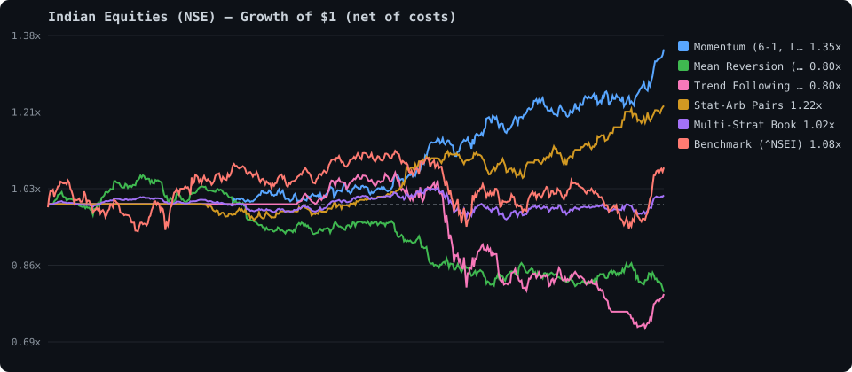
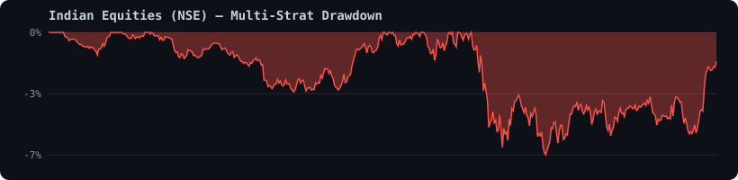
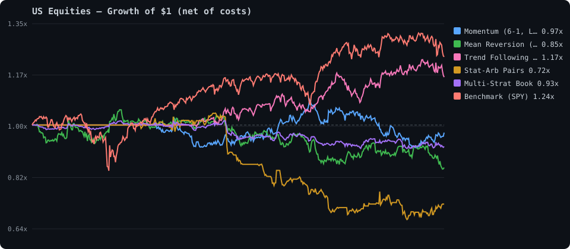

<div align="center">

# ⚡ quant-alpha

### A multi-strategy quantitative backtesting engine for **US & Indian equities**

*Four hedge-fund strategies · real market data · transaction-cost-aware · pure Python + NumPy*

[](https://www.python.org/)
[](https://github.com/Aman-cve/quant-alpha/actions/workflows/ci.yml)
[](LICENSE)
[](requirements.txt)


</div>

---

**quant-alpha** backtests a book of classic systematic strategies — **cross-sectional momentum, short-term mean-reversion, trend-following, and statistical-arbitrage pairs** — on real US large-caps and NSE (India) large-caps. It pulls live price history over the standard library, runs a vectorised, cost-aware backtest, and renders its own **SVG tearsheets** (no matplotlib, no pandas — just NumPy + SciPy).

> **Headline result:** on NSE large-caps, the **6-1 cross-sectional momentum** book delivered a **Sharpe of 1.10** with a **−3.5% max drawdown** and a **Calmar of 4.71**, versus the Nifty 50's −0.12 Sharpe over the same window — net of 5 bps round-trip costs.

---

## 📈 Performance — Indian Equities (NSE)




| Strategy | CAGR | Vol | **Sharpe** | Sortino | Max DD | Calmar |
|---|---:|---:|---:|---:|---:|---:|
| **Momentum (6-1, L/S)** | **+16.4%** | 8.2% | **1.10** | 1.34 | **−3.5%** | **4.71** |
| Stat-Arb Pairs | +10.7% | 6.9% | 0.57 | 0.72 | −5.3% | 2.01 |
| Multi-Strat Book | +1.0% | 5.2% | −1.03 | −1.02 | −6.9% | 0.15 |
| Mean Reversion (5d, L/S) | −10.6% | 9.6% | −1.80 | −1.78 | −24.5% | −0.43 |
| Trend Following (200d) | −10.8% | 13.0% | −1.32 | −1.42 | −32.5% | −0.33 |
| _Benchmark (Nifty 50)_ | _+4.1%_ | _13.4%_ | _−0.12_ | _−0.12_ | _−15.6%_ | _0.26_ |

## 📉 Performance — US Equities



| Strategy | CAGR | Vol | **Sharpe** | Sortino | Max DD | Calmar |
|---|---:|---:|---:|---:|---:|---:|
| **Trend Following (200d)** | **+8.1%** | 9.7% | **0.38** | 0.46 | **−8.6%** | **0.93** |
| Momentum (6-1, L/S) | −1.3% | 10.1% | −0.53 | −0.63 | −15.4% | −0.09 |
| Multi-Strat Book | −3.8% | 6.4% | −1.28 | −1.27 | −9.5% | −0.40 |
| Mean Reversion (5d, L/S) | −7.7% | 13.3% | −0.88 | −0.87 | −19.6% | −0.40 |
| Stat-Arb Pairs | −15.0% | 15.2% | −1.29 | −1.41 | −35.5% | −0.42 |
| _Benchmark (SPY)_ | _+11.3%_ | _16.9%_ | _0.45_ | _0.45_ | _−19.0%_ | _0.60_ |

<sub>Window: 2024-11-19 → 2026-11-19, daily bars. Costs: 5 bps per unit of turnover. Risk-free: 4.5% (US) / 6.5% (India). Numbers are reproducible — run `scripts/run_backtest.py`.</sub>

> 💡 **An honest read:** momentum and stat-arb shone on the NSE; mean-reversion and trend-following lagged in this particular regime. That's the point of a backtester — it tells you what *actually* worked, not what you hoped would. No cherry-picking, no survivorship-free fantasy curves.

---

## 🧠 The strategies

| Book | Idea | Construction |
|---|---|---|
| **Cross-sectional momentum** | Winners keep winning | Long top-3 / short bottom-3 by 6-month return (skipping the last month to dodge reversal); monthly rebalance; dollar-neutral |
| **Mean reversion** | Last week's losers bounce | Negative of the 5-day return, demeaned across the universe; daily rebalance; market-neutral |
| **Trend following** | Ride the primary trend | Equal-weight every name above its 200-day SMA, else cash (long-only, CTA-style) |
| **Statistical arbitrage** | Spreads revert | Picks the most-correlated pair in-sample, trades its z-scored, rolling-OLS-hedged spread with entry/exit hysteresis |

---

## 🏗️ How it works

```
         Yahoo chart API (stdlib urllib)                  numpy / scipy
                    │                                           │
             ┌──────▼──────┐     ┌──────────────┐     ┌─────────▼─────────┐
   symbols ─▶│  data.py    │────▶│  strategies/ │────▶│   backtest.py     │
             │ fetch+cache │     │ prices→weights│     │ cost-aware vector │
             └─────────────┘     └──────────────┘     └─────────┬─────────┘
                    │                                           │
             data/cache/*.csv                          ┌────────▼────────┐
            (committed, offline)                        │   metrics.py    │
                                                        │ Sharpe/DD/Calmar│
                                                        └────────┬────────┘
                                                                 │
                                                        ┌────────▼────────┐
                                                        │   charts.py     │
                                                        │ hand-rolled SVG │
                                                        └─────────────────┘
```

**Design choices that matter in interviews:**

- **No look-ahead bias.** `weights[t]` is computable from `prices[:t+1]` only; the backtester applies them to the `t → t+1` return. There's a unit test that *perturbs the future and asserts past weights don't move.*
- **Out-of-sample pair selection.** Stat-arb chooses its pair on a formation window, then trades the remainder — selection never sees the traded period.
- **Transaction costs are first-class.** Every rebalance pays `cost_bps × turnover`, so churny strategies (daily mean-reversion) are penalised honestly.
- **Dependency-light & reproducible.** No pandas, no matplotlib. Data is cached to CSV and committed, so `git clone && run` reproduces every number and chart offline.

---

## 🚀 Quickstart

```bash
git clone https://github.com/Aman-cve/quant-alpha.git
cd quant-alpha
pip install numpy scipy

# reproduce every table + chart from the committed data cache (offline):
python3 scripts/run_backtest.py

# refresh with the latest prices (needs internet):
python3 scripts/fetch_data.py --refresh

# run the test suite:
python3 -m unittest discover -s tests -v
```

---

## 🗂️ Project structure

```
quant-alpha/
├── quantalpha/
│   ├── data.py          # stdlib Yahoo fetch + CSV cache, panel alignment
│   ├── universe.py      # US + NSE large-cap universes & benchmarks
│   ├── backtest.py      # vectorised, cost-aware engine
│   ├── metrics.py       # CAGR, Sharpe, Sortino, max DD, Calmar, turnover
│   ├── charts.py        # dependency-free SVG tearsheets
│   └── strategies/      # momentum · mean_reversion · trend · pairs
├── scripts/
│   ├── fetch_data.py    # refresh the data cache
│   └── run_backtest.py  # run everything, print tearsheets, emit charts
├── data/cache/          # committed real price history (22 symbols)
├── reports/             # generated SVG charts
└── tests/               # 13 unit tests incl. no-look-ahead check
```

---

## ⚠️ Disclaimer

This is a **research and engineering project**, not investment advice. Backtested performance is hypothetical, excludes slippage/liquidity/borrow costs, and **past results do not predict future returns.** Don't trade real money off it.

---

<div align="center">

**Built by [Aman](https://github.com/Aman-cve)** · ML/Quant engineering · open to opportunities

<sub>If you found this interesting, a ⭐ is appreciated.</sub>

</div>
